

  

  <h1>Dusklight — Alek's Ultimate NX Edition</h1>

  
<b>A free, unofficial Nintendo Switch port of <a href="https://github.com/TwilitRealm/dusklight">Dusklight</a></b> 
  by <a href="https://github.com/Alexgg1014">Alexgg1014</a> · version <code>1.0.0</code>

  

    <a href="https://github.com/Alexgg1014/The-Legend-of-Zelda-Twilight-Princess-Alek-s-Ultimate-NX-Edition/releases/latest"><b>Download</b></a>
    •
    <a href="docs/user/install.md">Install</a>
    •
    <a href="docs/user/faq.md">FAQ</a>
    •
    <a href="docs/README.md">Documentation</a>
  

> [!IMPORTANT]
> **Fan project. Not affiliated with Nintendo. Requires your own copy of the game.**
> No game data is included. You need a dump of your own *Twilight Princess* disc (GameCube or Wii).
> *The Legend of Zelda* and *Twilight Princess* are trademarks of Nintendo.

> [!IMPORTANT]
> **Free, forever.** This port and the mod ports made for it are never sold, and no build is held back behind a
> donation or a paywall. **If you paid for this, you got scammed.** The only official download is this repository's
> [Releases page](https://github.com/Alexgg1014/The-Legend-of-Zelda-Twilight-Princess-Alek-s-Ultimate-NX-Edition/releases/latest).

> [!NOTE]
> **Not an official Dusklight release.** It is not affiliated with or endorsed by Twilit Realm. Dusklight's website is
> https://twilitrealm.dev/. Please report problems with this port here, not to the Dusklight team.

## What it is

[Dusklight](https://github.com/TwilitRealm/dusklight) is Twilit Realm's reimplementation of *Twilight Princess*,
built on the [Twilight Princess decompilation](https://github.com/zeldaret/tp). This project builds it as a Switch
homebrew app (`.nro`) and adds what a handheld console needs:
- a Switch platform layer;
- a renderer tuned for the console;
- motion controls;
- support for the PC mod catalog;
- tools for measuring performance.

The game draws through [Aurora](https://github.com/encounter/aurora). On the Switch it uses the deko3d renderer by
default, with Dawn (WebGPU) on Mesa's Vulkan driver as the alternative.

## Features

**Runs well at stock clocks**
- The goal is the game's own **30 FPS at stock clocks**, and 30 FPS is not a fallback here.
- **Settings → Aleks → Performance** has three presets:
  - **Quality** keeps 30 with everything at its best.
  - **Balanced** and **Performance** interpolate up to 60 where the console keeps up.
- No preset touches the clocks. **GPU Boost (handheld)** is optional and off by default: it asks the console for
  its own official 460 MHz handheld GPU profile, which is not an overclock.
- The resolution is chosen automatically for docked, handheld and Flip Grip play, or by hand.
- The deko3d renderer prepares shaders in seconds, so there is no long shader preparation at first start.

**Plays like a Switch game**
- Joy-Con, the Pro Controller and handheld mode.
- **HD Rumble**, with an intensity slider.
- **Gyro aiming**.
- Optional **Wii-style sword swings**, marked experimental. The buttons always keep working.
- Disc images read straight from the SD card: `.iso`, `.gcm`, `.rvz`, `.wia` and `.gcz`.
- A Saves window to export, import and copy saves between profiles.
- Updates from inside the game.
- A **Flip Grip** companion screen (off by default): the game on top, and a touch dashboard below with items, the
  dungeon map and a guide reader.

**Mods**
- An in-game browser for the Twilit Realm catalog. On 20 October 2026, 66 of its 69 mods passed this build's checks.
- Mods made for PC run on the Switch without their authors rebuilding them.
- Randomizer is built in, with a **Play / Randomizer** selector on the main menu.
- [Texture packs](docs/user/texture-packs.md), [online co-op](docs/user/co-op.md) through the catalog's Crests of Courage,
  and **Cloud Save**, built in: optional [cross-save](docs/user/cross-save.md) between Switch and PC.
- A safety net: a mod that crashes the game at start is turned off at the next start, and the game says which one.

See [Mods](docs/user/mods.md) for what has been tested on the console and what is known not to work.

**For testers and the curious**
- A benchmark, performance tours and a session log, all in **Settings → Aleks → Diagnostics**.
- A Recording Mode that hides every overlay.

## Screenshots

Taken on a Switch with version 1.0.

<table>
  <tr>
    <td>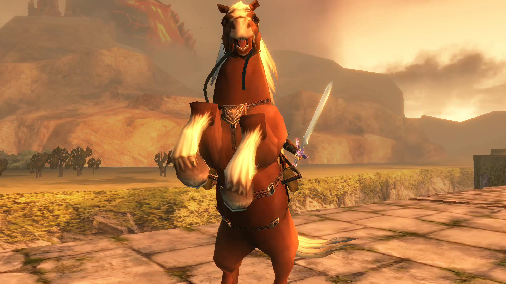</td>
    <td>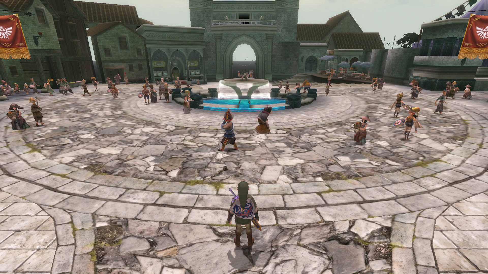</td>
    <td>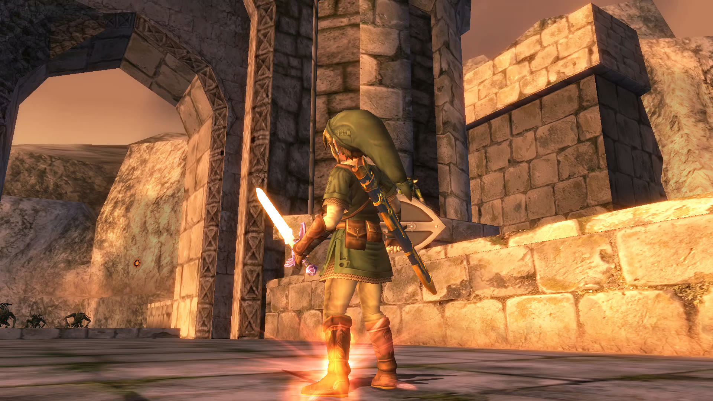</td>
  </tr>
  <tr>
    <td align="center">Hyrule Field at golden hour</td>
    <td align="center">Castle Town</td>
    <td align="center">Hyrule Castle at sunset</td>
  </tr>
  <tr>
    <td>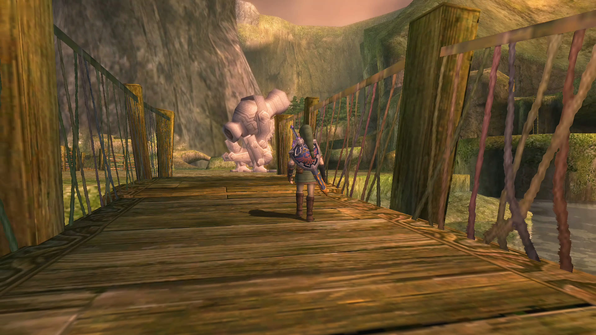</td>
    <td>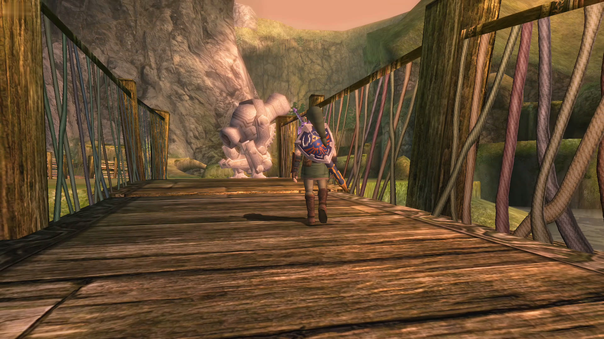</td>
    <td>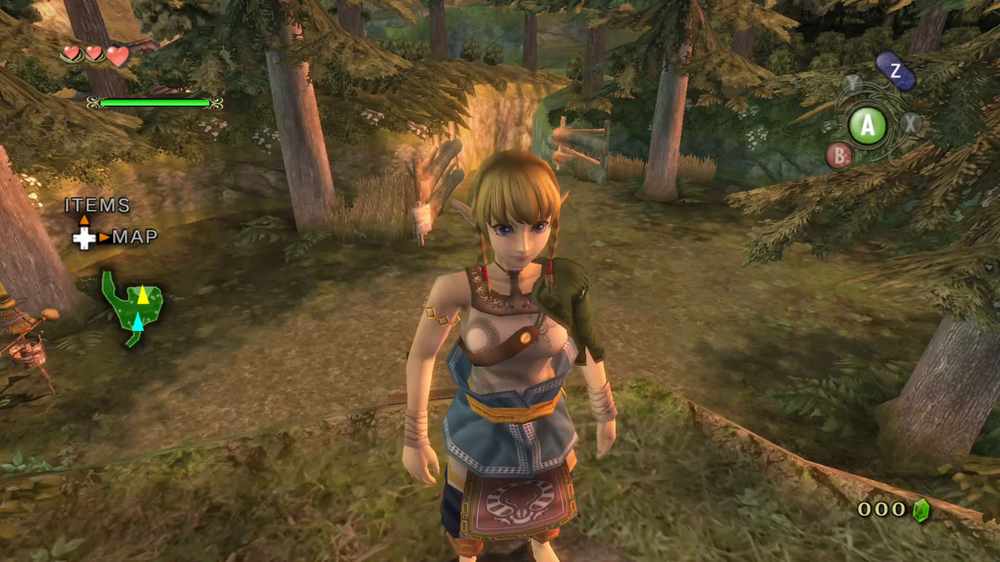</td>
  </tr>
  <tr>
    <td align="center">Original textures…</td>
    <td align="center">…and with Storm's Dusklight HD pack</td>
    <td align="center">Linkle Mod</td>
  </tr>
  <tr>
    <td>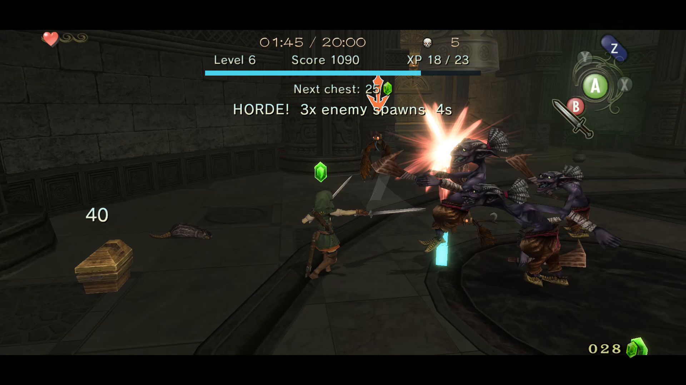</td>
    <td>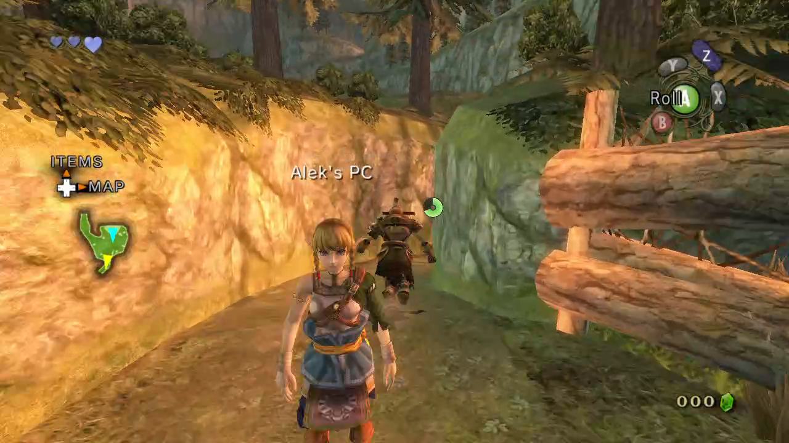</td>
    <td>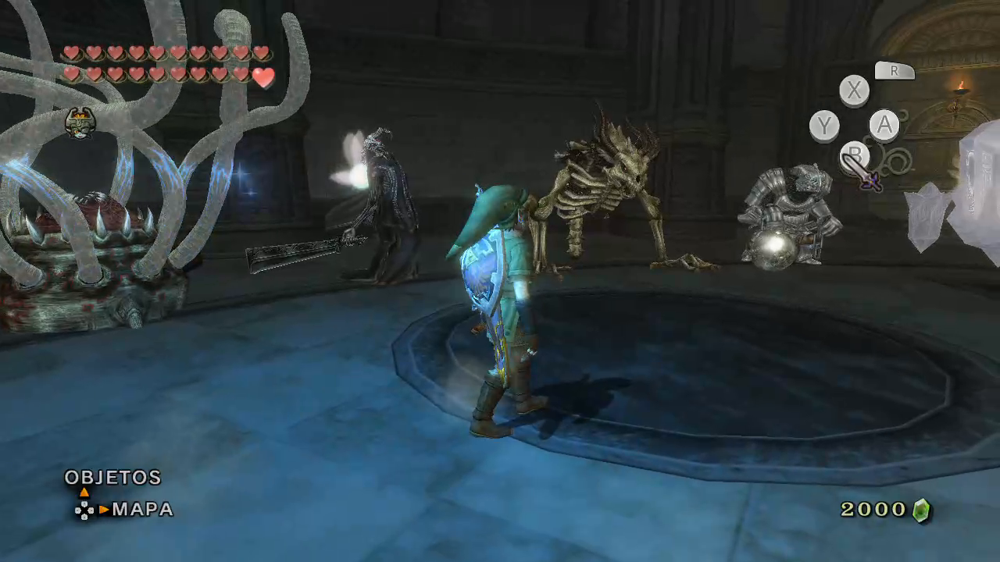</td>
  </tr>
  <tr>
    <td align="center">Dawnlight: Hyrule Survivors</td>
    <td align="center">Online co-op, Switch and PC</td>
    <td align="center">Twilit Essentials: Boss Rush</td>
  </tr>
  <tr>
    <td>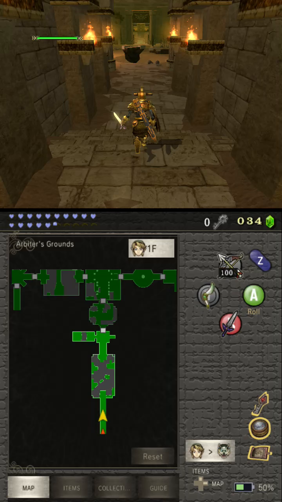</td>
    <td>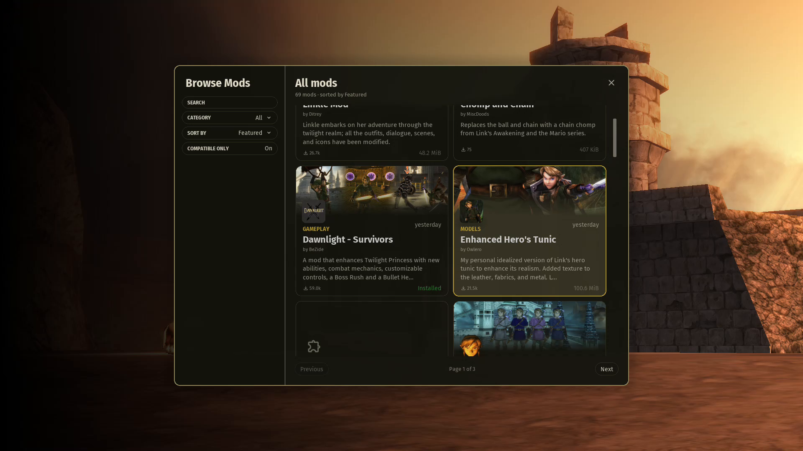</td>
    <td>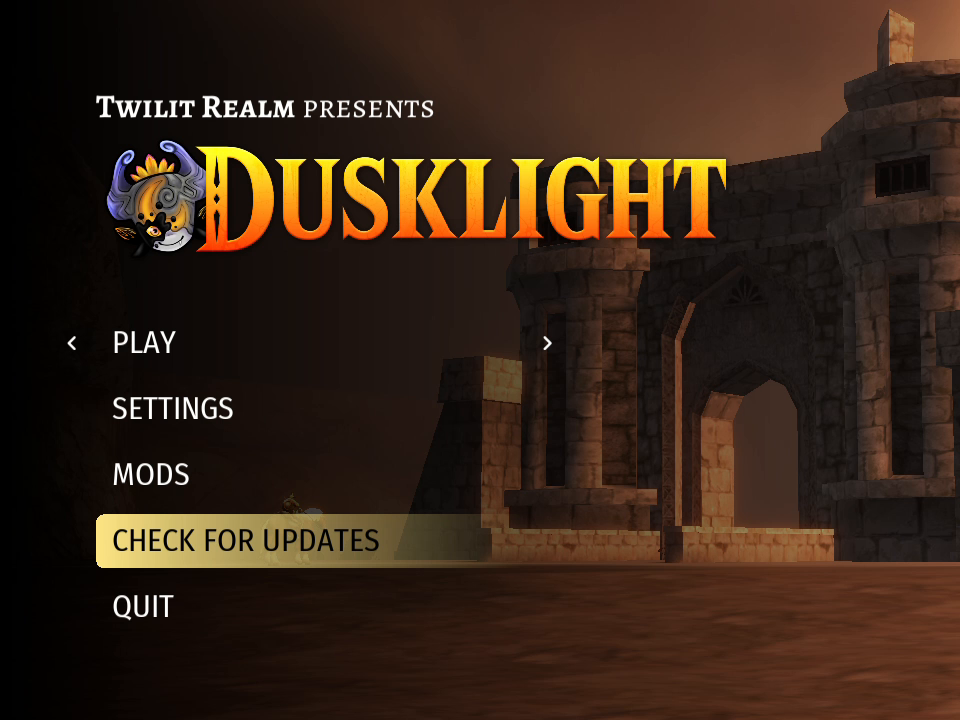</td>
  </tr>
  <tr>
    <td align="center">Flip Grip (optional)</td>
    <td align="center">The in-game mod catalog</td>
    <td align="center">Main menu</td>
  </tr>
</table>

The HD textures are Storm's Dusklight HD pack, downloaded separately; mods are their authors' work.

## Install

1. Download the release ZIP from the
   [Releases page](https://github.com/Alexgg1014/The-Legend-of-Zelda-Twilight-Princess-Alek-s-Ultimate-NX-Edition/releases/latest).
2. Copy its `switch` folder to the root of your SD card.
3. Put your disc image in `sdmc:/switch/dusklight/`.
4. Start the port by holding **R** on a game title in the HOME menu, not from the Album.

Back up `sdmc:/switch/dusklight/` before updating: it holds your saves, settings and mods. The full guide is in
[docs/user/install.md](docs/user/install.md).

## FAQ and support

- [FAQ](docs/user/faq.md) and [Troubleshooting](docs/user/troubleshooting.md).
- **Bugs:** open an issue on this repository. Attach the newest log from `sdmc:/switch/dusklight/cache/logs/`. If
  the game crashed, also attach the newest file from `sdmc:/atmosphere/crash_reports/`.
- There is no paid support, and nothing to buy.

## Provenance

- **Original work.** Alek's Ultimate NX Edition is the work of Alexgg1014. It is built on Dusklight by Twilit Realm
  and on Aurora, and the people whose work it uses are credited below.
- **Independent.** It is developed independently of the other Switch forks of Dusklight.
- **Inherited code replaced.** Development began in September 2026 on top of an earlier community NX fork. That
  fork's code was then removed, swapped for public upstream code, or rewritten.
  - The work was completed and validated on a console on **1 October 2026**.
  - Every line that still matches is accounted for, file by file, in a ledger: API signatures, one-line boilerplate,
    or independent rewrites.
- **Fresh public history.** This repository started on **5 October 2026** from a fresh history, without the earlier
  fork's commits.

The details, dates, figures and the measuring tool are in [docs/provenance/PROVENANCE.md](docs/provenance/PROVENANCE.md).
The ledger is [platforms/switch/tools/provenance-ledger.json](platforms/switch/tools/provenance-ledger.json).

## How this port was made

This port was made by one person working with two AI assistants. Each did different work.

**Aleks (Alexgg1014).**
- **Direction and decisions:** the goals, the limits (30 FPS at stock clocks rather than a promise of 60, motion
  controls that stay optional), and what goes into each release. Aleks accepted or rejected every result.
- **Ideas and feedback:** features, bug finding, and the feedback that only comes from playing.
- **Console testing:** every candidate build was tested on Aleks's own Switch. Those logs, crash reports and
  screenshots drove the next build.
- **People and permissions:** talking to the authors whose work this port builds on, and getting their permission.
- **Visual identity:** the "Alek's Ultimate" name, logo, icon and screenshots.

**ChatGPT (OpenAI):** technical research and diagnosis, milestone planning and task briefs, reviews of reports and
logs, and help with the artwork.

**Claude (Anthropic, through Claude Code):** most of the Switch port's code (the platform layer, the companion
screen integration, motion controls, the native mod loader and its checks, the renderer work, the build tooling),
the host tests, every build and its verification, and most of the documentation.

Every claim that a feature or a mod works comes from a test on real hardware. Where something was only checked
statically, the documentation says so. Upstream Dusklight does not accept AI-generated contributions, so none of
this is meant to be sent upstream.

## Credits

**Upstream**
- **[Twilit Realm](https://github.com/TwilitRealm/dusklight)**, for Dusklight itself. This port is their work with
  a Switch layer on top.
- **[encounter](https://github.com/encounter)**, for [Aurora](https://github.com/encounter/aurora), the Dawn fork
  with Switch support, borealis and [nod](https://github.com/encounter/nod).
- The **[Twilight Princess decompilation](https://github.com/zeldaret/tp)** team and the GC/Wii decompilation
  community.
- The [TP speedrunning community](https://zsrtp.link).

**Switch work this port builds on**
- **centollOS** (Pulpparty, depende3000 and the SwitchWaker contributors):
  [SwitchWaker](https://github.com/centollOS/SwitchWaker) (MIT), the base our deko3d renderer (Aurora's `lib/deko`) was
  built from, and the trigger-axis buttons for remapping.
- **PalindromicBreadLoaf**, for pioneering deko3d on the Switch with a Wii emulator: the deko3d work we learned from.
- **ChanseyIsTheBest**: ideas from Renut (`renut_nx`) for the deko3d renderer, and ideas from `sa2-nx` and
  `banjo-nx` for frame pacing, profiling and the profile-guided build, used with permission.
- **igawa6**: the [Dusklight Dual-Screen fork](https://github.com/igawa6/dusklight) (CC0). The companion screen
  comes from it.
- **HayatoG**: the original Switch layer, `switch-nvk` and the SQLite VFS fix, used with permission.
- **danfromtico**: Mesa for Horizon (`mesa-switch`), the Vulkan driver this port links, used with permission.

**Texture packs and mods**
- **Storm**, for Dusklight HD.
- **Twilit Realm**, for Dusklight Randomizer and Cosmetics.
- **Fimmel**, for Twilit Essentials.
- **MelonSpeedruns**, for Roll and Sprint.
- **XandasLegend**, for Cowboy Link and TP Classic Modern Controller UI.
- **BeZide**, for Dawnlight.
- **cgwolf**, for Twilight Compass.
- **remi**, for Crests of Courage, the co-op mod.
- **automata**, for Deferred Fog.
- Every author in the Twilit Realm catalog. Mods are their authors' work. Where a mod does not work on this Switch
  build, that says nothing about how it works on the platforms it was made for.

**Testers:** Yuh_Yuh, angel_hp, Traveling Swordsman, Boldiatti, Juls, JAGSTAX and Joe-bi Wan.

**Beta reports:** Raul8, Geneolgia and JAVELIN.

**Tools and libraries:**
- [devkitPro](https://devkitpro.org/): devkitA64, libnx and the [Switch branch of SDL3](https://github.com/devkitPro/SDL).
- [Atmosphère](https://github.com/Atmosphere-NX/Atmosphere).
- [Dawn/Tint](https://dawn.googlesource.com/dawn), [Mesa](https://mesa3d.org/), [RmlUi](https://github.com/mikke89/RmlUi),
  [Luau](https://luau.org/), [Tracy](https://github.com/wolfpld/tracy) and [funchook](https://github.com/kubo/funchook).
- The full list is in the [third-party notices](docs/provenance/third-party-notices.md).

## License

- This repository follows Dusklight's license, **CC0** (see [LICENSE.md](LICENSE.md)).
- Third-party components keep their own licenses: Aurora MIT, `lib/deko` MIT, Dawn BSD, SDL3 zlib, the Mesa driver
  MIT, and funchook GPL-2.0-or-later with a linking exception (its source ships with each release).
- Mods keep their authors' licenses.

See [docs/provenance/licenses.md](docs/provenance/licenses.md) and the
[third-party notices](docs/provenance/third-party-notices.md).

*Fan project. Not affiliated with Nintendo. Requires your own copy of the game.*

 

    

