<div align="center">
  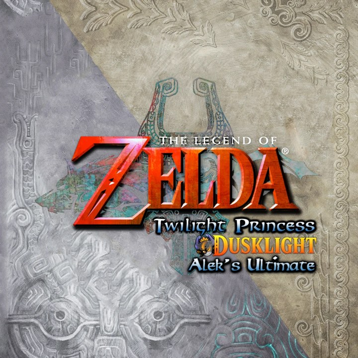

  <h1>Dusklight — Alek's Ultimate NX Edition</h1>

  <p><b>An unofficial Nintendo Switch homebrew port of <a href="https://github.com/TwilitRealm/dusklight">Dusklight</a></b><br>
  Public beta <code>1.0.0-beta.1</code></p>

  <p>
    <a href="https://github.com/Alexgg1014/The-Legend-of-Zelda-Twilight-Princess-Alek-s-Ultimate-NX-Edition/releases/latest"><b>Download latest beta</b></a>
    •
    <a href="#installing">Installation</a>
    •
    <a href="#known-issues">Known issues</a>
  </p>
</div>

> [!IMPORTANT]
> **This is a fan fork, not an official Dusklight release.** It is not affiliated with or endorsed by Twilit Realm,
> and it is not affiliated with Nintendo. Dusklight's official website is https://twilitrealm.dev/. Please do not report
> problems with this port to the Dusklight team; open an issue here instead.

> [!IMPORTANT]
> **No game data is included.** You need your own copy of *Twilight Princess* (GameCube or Wii disc) dumped from a disc
> you own. *The Legend of Zelda* and *Twilight Princess* are trademarks of Nintendo.

> [!WARNING]
> **Built with heavy use of AI.** Most of the code, tests and documentation of the Switch port were written by Claude
> (Anthropic), with research and planning help from ChatGPT (OpenAI), under the direction and console testing of one
> person. Read [How this port was made](#how-this-port-was-made) before using or reusing it. Upstream Dusklight does not
> accept AI-generated contributions, so none of this is meant to be sent upstream.

## What it is

Dusklight is a reverse-engineered reimplementation of *Twilight Princess*, built on the
[Twilight Princess decompilation](https://github.com/zeldaret/tp). This fork builds it as a Switch homebrew (`.nro`).
The game draws through Aurora and Dawn (WebGPU) on the Mesa Vulkan driver for Horizon; window, audio and controllers
go through SDL3 on libnx.

## What this port adds

The port and its core features were tested on a real Switch. Specific hardware results and limitations are identified
below. Settings marked *Aleks* are in **Settings → Aleks**; the motion controls are in **Settings → Input**.

### Runs on the Switch

- **Docked, handheld and Flip Grip**, with the resolution chosen for each automatically (see the profiles below).
  - A resolution picked by hand replaces Auto.
  - The resolution actually rendered is still limited to 720p handheld and 1080p docked.
- **Disc images**: `.iso`, `.gcm`, `.rvz`, `.wia` and `.gcz`, read straight from the SD card. A disc picker at start
  lists the images in `sdmc:/switch/dusklight/` and `sdmc:/switch/dusklight/discs/`.
- **Version and identity**: the menu shows `1.0.0-beta.1`, and hbmenu shows the Alek's Ultimate icon.

### Performance profiles

**Settings → Aleks → Performance → Optimized Settings** has three profiles. Each sets interpolation, shadows, bloom,
depth of field and an automatic resolution:

| Profile | What it does | Auto resolution | Seen on the console (handheld, stock clocks) |
|---|---|---|---|
| **Quality** | The game's own 30 FPS with everything at its best: 4× shadows, Dusk bloom, depth of field | 900p docked · 720p handheld · 540p Flip Grip | Steady **30 FPS** (median 30.0 over 110 samples) |
| **Balanced** | Fancy frame interpolation capped at 60 with predictive skipping; where the console cannot keep up it falls back to a clean 30. 2× shadows, Classic depth of field | 720p docked · 540p handheld | **30–60 FPS**: median 29.5 in Ordon and Hyrule Field, 47 with the Flip Grip companion screen |
| **Performance** | Fast interpolation capped at 60 with predictive skipping, 1× shadows, Classic bloom, no depth of field or water refraction | 720p docked · 540p handheld | Observed median **51 FPS** in the tested lighter scenes, with peaks near 60 |

How to read these numbers:
- They are the game's own once-every-30-seconds log samples from 17 sessions on 4–5 October 2026, mostly in Ordon
  Village and Hyrule Field.
- They are not a formal benchmark, and they do not cover docked play.
- The lowest samples, down to 0, are loading screens and shader compilation, not gameplay.
- At stock clocks, towns, caves and Castle Town are limited by the render thread; no profile changes that.
- 30 FPS is the goal; 60 is reached only where the console keeps up.
- Predictive interpolation can be switched off. Dynamic resolution is not ready and stays **off** in this beta.

### Flip Grip companion screen

With a Flip Grip the console is held upright: the game on top and a touch dashboard below.
The dashboard has items (drag one onto X or Y), collection, a dungeon map by floor, and a guide reader. It is set up in
**Settings → Aleks → Companion**. It is an extra; docked and handheld play does not need it.

### Controls

- **Joy-Con, the Pro Controller and handheld mode** all work. Nothing below replaces the buttons.
- **Gyro aiming** (Settings → Input → Gyro). Gyro aiming works on the console; the list of supported uses comes
  from the game's own settings and was not tested one by one:
  - look mode and the hawk;
  - the Slingshot, Gale Boomerang, Hero's Bow, Clawshots, Ball and Chain and Dominion Rod;
  - tilting the Rollgoal table.

  Sensitivity, deadband, smoothing and inversion can be adjusted.
- **Optional Wii-style motion controls** (Settings → Input → Wii-style Motion):
  - Swing the right Joy-Con to swing the sword; the direction of the swing picks the cut.
  - With two detached Joy-Con, move the left one (the "Nunchuk") sideways for the spin attack, or push it forward for a
    shield bash.
  - Choose which Joy-Con is the sword hand.
  - Recenter by holding L3 + R3 for half a second.
  - The buttons always keep working.
  - Sword swings were tested on the console.
- **Touch** on the companion screen.

### Mods

- **Native code mods from the SD card.** `.dusk` packages with a Linux AArch64 or Switch library load at run time.
  **Settings → Aleks → Diagnostics → Native Mods: Loader Mode** controls how:

  | Mode | What happens |
  |---|---|
  | **Dry Run** (default) | Each library is checked against this build and a report is written to `mods/.reports/`; no mod code runs |
  | **Execute** | Same checks, then the mod runs. Native mods, including Randomizer and Twilit Essentials, need this mode |

- **Safety net.** A mod that crashes the game while starting is turned off at the next boot, and the game says why. An
  empty file named `start_without_mods` in `sdmc:/switch/dusklight/mods/.guard/` starts the game with no mods at all.
- **Bundled Switch builds** of **Dusklight Randomizer 1.0.6** and **Twilit Essentials 2.5.0** (`switch-arm64`). The
  main menu has a **Play / Randomizer** selector.
- **In-game mod browser** for the Twilit Realm catalog. It blocks exact package releases known to crash on this
  build; other releases of the same mod stay installable. It never replaces the bundled Switch builds with the
  catalog's Linux copies. See [Mod compatibility](#mod-compatibility).
- **Luau script mods** run on the built-in Luau runtime.

### Tools (Settings → Aleks → Diagnostics)

- **Prepare Shaders**: visits six places (Hyrule Field, Castle Town, Ordon Village, Link's House, Faron Woods, the
  Forest Temple) and compiles their shaders ahead of time, so those places do not stutter the first time. Up to about
  15 minutes the first time.
- **Run Benchmark**: measures a heavy, known scene (Hyrule Field outside Castle Town) with your current settings and
  writes a JSON report.
- **Run Profile Matrix**: runs the benchmark once with each profile and writes one report per profile (about 5
  minutes). Your settings are given back afterwards.
- **Run Performance Tour**: measures three places, from heavy to light (outside Castle Town, Ordon Village, Link's
  House), in about 3 to 5 minutes.
- None of these tools writes to your save; press Start to cancel any of them.
- A **session log** in `sdmc:/switch/dusklight/cache/logs/`: settings, zones and a frame-rate heartbeat every 30
  seconds. It is what to attach to a bug report.

## Screenshots

Taken on a Switch with the public beta.

### Playing

<table>
  <tr>
    <td>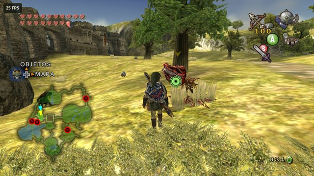</td>
    <td>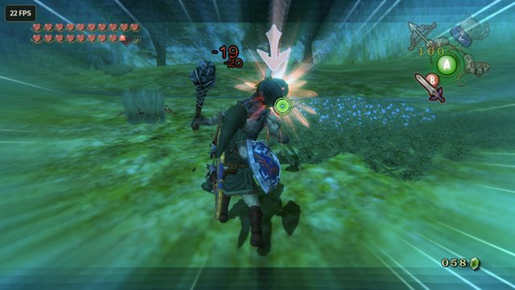</td>
    <td>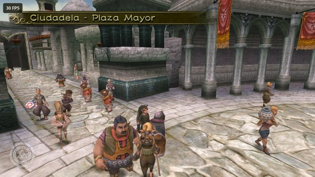</td>
  </tr>
  <tr>
    <td align="center">Hyrule Field</td>
    <td align="center">Combat</td>
    <td align="center">Castle Town</td>
  </tr>
  <tr>
    <td>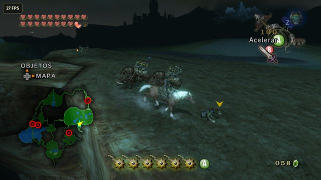</td>
    <td>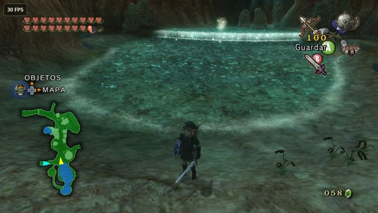</td>
    <td>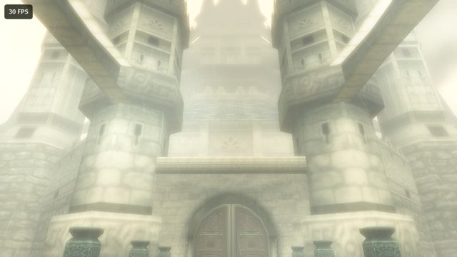</td>
  </tr>
  <tr>
    <td align="center">On Epona at night</td>
    <td align="center">A spring</td>
    <td align="center">Hyrule Castle</td>
  </tr>
</table>

### Menus and options

<table>
  <tr>
    <td>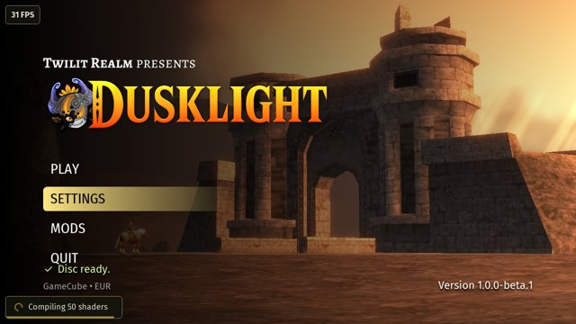</td>
    <td>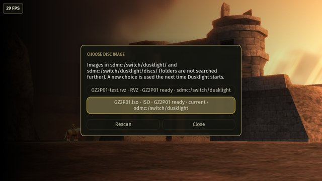</td>
    <td>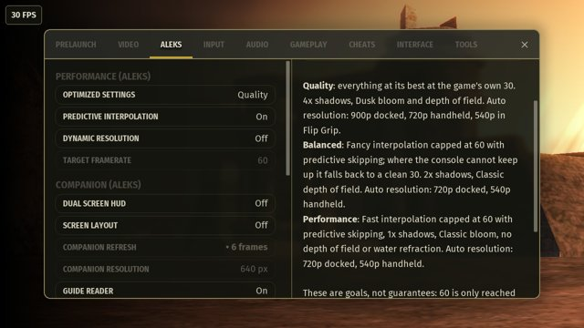</td>
  </tr>
  <tr>
    <td align="center">Main menu, version 1.0.0-beta.1</td>
    <td align="center">Choosing a disc image</td>
    <td align="center">Performance presets</td>
  </tr>
  <tr>
    <td>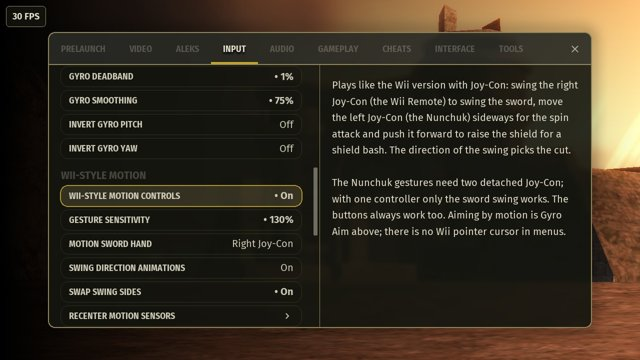</td>
    <td>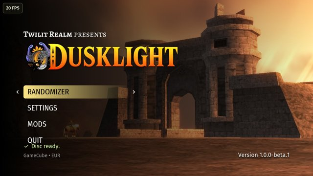</td>
    <td>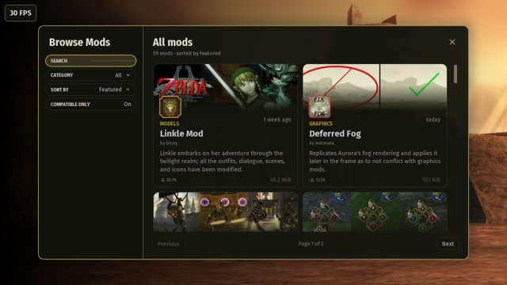</td>
  </tr>
  <tr>
    <td align="center">Optional Wii-style motion controls</td>
    <td align="center">Play / Randomizer selector</td>
    <td align="center">In-game mod browser</td>
  </tr>
  <tr>
    <td>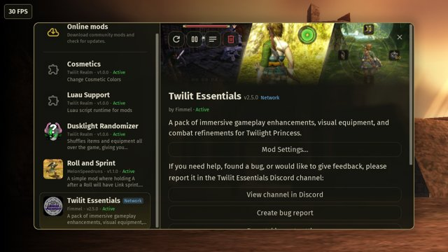</td>
    <td>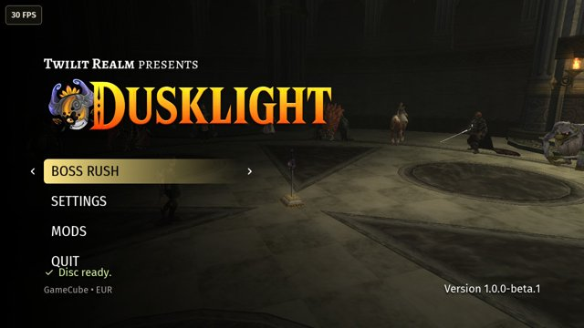</td>
  </tr>
  <tr>
    <td align="center">Installed mods</td>
    <td align="center">Twilit Essentials: Boss Rush</td>
  </tr>
</table>

### Flip Grip (extra)

With a Flip Grip the console is held upright: the game on top, a touch companion screen below.

<table>
  <tr>
    <td>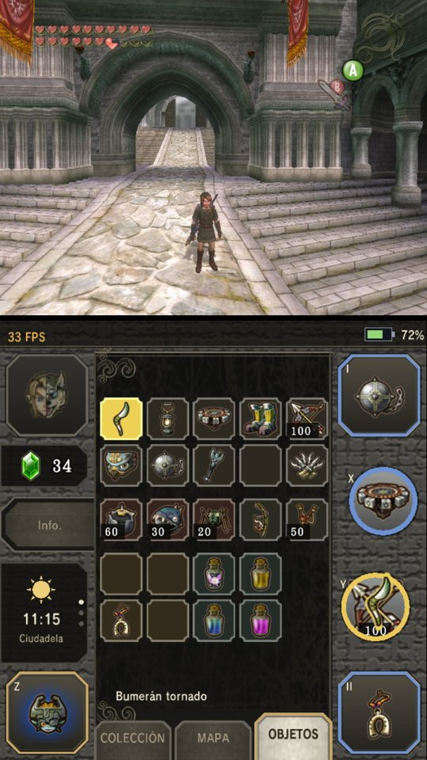</td>
    <td>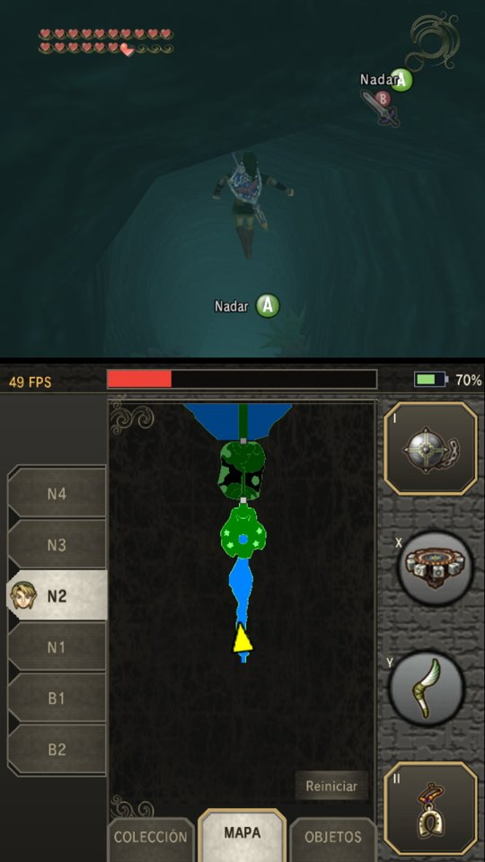</td>
    <td>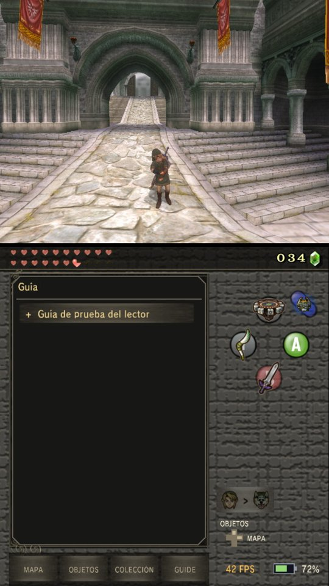</td>
  </tr>
  <tr>
    <td align="center">Items</td>
    <td align="center">Dungeon map, by floor</td>
    <td align="center">Guide reader</td>
  </tr>
</table>

## Installing

Requirements: a Switch that can run homebrew (Atmosphère and hbmenu), and a dump of your own disc.

> [!WARNING]
> **Back up first.** If you already use Dusklight, close the game and back up the entire `sdmc:/switch/dusklight/`
> folder before extracting this update. It contains your saves, settings, mods and mod data.

1. Download `Alek-Ultimate-NX-v1.0.0-beta.1.zip` from the [latest release](https://github.com/Alexgg1014/The-Legend-of-Zelda-Twilight-Princess-Alek-s-Ultimate-NX-Edition/releases/latest)
   and extract its contents to the **root** of your SD card. You get:

   ```
   sdmc:/switch/dusklight-aleks/dusklight.nro
   sdmc:/switch/dusklight/mods/randomizer.dusk
   sdmc:/switch/dusklight/mods/twilit_essentials.dusk
   ```

   When updating, extracting replaces your existing copies of `randomizer.dusk` and `twilit_essentials.dusk`.
   These are the bundled Switch (`switch-arm64`) builds of Randomizer and Twilit Essentials. Do not replace them with
   the catalog's copies: those are Linux builds and do not work here.
2. Copy your disc image (`.iso`, `.gcm`, `.rvz`, `.wia` or `.gcz`) to `sdmc:/switch/dusklight/` or
   `sdmc:/switch/dusklight/discs/`. To dump a disc, see [Dolphin's guide](https://wiki.dolphin-emu.org/index.php?title=Ripping_Games).
   Dolphin or [nodtool](https://github.com/encounter/nod/releases) can convert an `.iso` to `.rvz` to save space.
3. Launch it from hbmenu and pick the disc.
4. To use Randomizer and Twilit Essentials, set **Settings → Aleks → Diagnostics → Native Mods: Loader Mode** to
   **Execute** and restart the game. The default mode, Dry Run, only checks native mods and does not run them.

`SHA256SUMS.txt` in the ZIP lists the SHA-256 of the three files.

**Where your data lives.** Everything the game writes goes to `sdmc:/switch/dusklight/`, not to the folder of the
`.nro`: settings (`config.json`), achievements, `mods/`, `mod_data/`, caches and logs (`cache/logs/`). **Your save is
in the same folder** (`USA/`, `EUR/` or `JAP/`, and `MemoryCard*` files). Back up that folder before you try a new
build or a new mod.

**Other mods.** Put `.dusk` packages in `sdmc:/switch/dusklight/mods/`, or install them from the in-game browser.
Native code mods also need Loader Mode set to Execute.

## Mod compatibility

Mods were checked against the 59 packages of the Twilit Realm catalog on 4 October 2026; TP Classic Modern Controller UI
1.3.2, published after that, was tested on the console on 5 October 2026. Mods tested on the console are not the same
as mods that only passed the static checks. "Statically compatible" means the package passed the
platform, ABI, import, hook and service checks against this build. It does **not** mean it was run: a package can pass
every check and still crash, as two of them did.

### Tested on the console

| Mod | Version | Status |
|---|---|---|
| Dusklight Randomizer | 1.0.6 (`switch-arm64`, bundled) | Works: seeds, starting and loading a game |
| Twilit Essentials | 2.5.0 (`switch-arm64`, bundled) | Works |
| Cosmetics | 1.0.0 | Works |
| Roll and Sprint | 1.1.0 | Works |
| Luau runtime | built in | Works (individual Luau mods are not certified) |
| Cowboy Link | 1.1.0 | Works |
| TP Classic Modern Controller UI | 1.3.2 (release package, SHA-256 `8ea68862…452e`) | Works in the tested gameplay and UI scenarios with Loader Mode Execute (Linux compatibility mode). Avoid disabling it during active gameplay: one display-mode change followed by a hot-disable ended in an Aurora texture conversion failure. Return to the title screen and restart after disabling it. |

### Known incompatible — do not install

| Mod | Version | Why |
|---|---|---|
| **TP Classic Modern Controller UI** | 1.3.1, old Debug package (SHA-256 `be891f39…22fd`) | **Crashes the game.** That Linux library was a Debug build that reads the game's memory with a different layout. The browser blocks this exact package. The current release, 1.3.2, works (see above). |
| **Deferred Fog** | 2.0.0 | **Crashes the game** while compiling its `fog.wgsl` shader: the Dawn/Tint worker thread runs out of stack. The browser blocks it. |
| Dusklight Randomizer (catalog copy) | 1.0.5 | Linux build (TLS, Linux C++ streams). Use the bundled 1.0.6 `switch-arm64` build. |
| Twilit Essentials (catalog copy) | 2.5.0 | Linux build (TLS). Use the bundled `switch-arm64` build. |
| A Link Between Twilight | 0.3.0 | Linux C++ stream ABI; a Switch build needs `dlsym`, which Horizon does not have |
| Dawnlight | 3.8.x – 3.9.x | TLS, Linux C++ streams, and too many hook pages |
| Crests of Courage | 1.8.4 | TLS, C++ streams, network service |
| Dark Link (native) | 1.1.3 | TLS |
| Dusklight Item Tracker | 1.1.0 | C++ streams, network service |
| MFB Multiplayer | 0.2.0 | TLS, C++ streams, `fork`, websocket |
| TPTracker | 0.4.40 | TLS, C++ streams |
| Dual Screen Companion · Ragdoll Mod · Twilight Princess Arabic (Android) | — | No Switch-usable library (Android-only or Windows-only) |

Only the TP Classic 1.3.1 Debug package and Deferred Fog 2.0.0 were proven to crash on the console; the rest were judged
statically. The block is tied to the mod's id, version and package hash, so a later release of a blocked mod is shown
as *Unverified*, not blocked.

### Not tested yet (statically compatible)

These may work, but nobody has run them on a Switch with this build yet. Test them **one at a time**.

| Kind | Mods |
|---|---|
| Native | Fairy Companion 1.0.0, KH2 Camera 1.0.1, Beta Quest 0.1.1, Dawnlight Custom Glider 1.3.0, Dialogue Options 1.0.1, Dusklight GZ 0.2.3, Evil Interlacing Mod 1.2.0, Extra Buttons 1.0.2, Ganondorf 1.0.0, Hero's Shade 1.0.0, Lazy Shield Rework 1.0.0, Manual Jumps 1.0.0, No Underwater Filter 1.0.0, Nozzlys random QoL 1.1.2, Time Sync Neo 1.3.1, Twilight Compass 1.0.2, Unrestricted Items 1.1.1, VBAO 1.1.0 |
| Resources only | ALTTP Master Sword (Blue Glow, No Glow, White Glow) 1.0.0, Arachnophobia 1.0.0, Bahasa Indonesia 1.1.0, Chinese Translation (DeepSeek Ver) 1.0.2, Enhanced Hero's Tunic 1.0.7, Fighter's Sword 1.0.0, HD Blue Tunic (Gold Stitching) 1.0.0, Hungarian Translation 1.0.1, Hylian Shield 1.0.0, Lokomo Master Sword 1.0.0, Nightwalker Epona 2.0.0, Ordonian Hero 1.0.0, Recruit Ordon Sword 1.0.0, Red Shield 1.0.0 |
| Luau | Linkle Mod 1.1.1, Play as Dark Link 1.0.0, Twilight Princess PT-BR 1.15.0 |

Hooks take code memory from a fixed table of 512 pages. The audited worst-case combination of Randomizer, Twilit
Essentials, the bundled mods, Cowboy Link, Fairy Companion, KH2 Camera and TP Classic 1.3.2 would use 489 of 512 pages,
leaving 23. Do not expect every mod to fit at once. Chicken
Bombs, Cutscene Player, Zora Swim, Zelda on Epona, Hyrule Hide & Seek and Dark Morpheel need more work before they can
load.

The full matrix and how it was produced are in [docs/switch-h38-mods.md](docs/switch-h38-mods.md).

## Known issues

- Deferred Fog 2.0.0 and the old TP Classic 1.3.1 Debug package crash the game (see above).
- Twilit Essentials logs one hook that cannot be installed ("Too short instructions") and a UI warning. It works anyway.
- If either shader-cache database is reported as malformed, close the game and remove or move
  `cache/pipeline_cache.db` and `cache/dawn_cache.db` (in `sdmc:/switch/dusklight/`). They will be recreated as shaders
  are encountered, so the first minutes may stutter.
- This is a beta. Back up `sdmc:/switch/dusklight/` (it includes your save) before every new build.

## How this port was made

This port was made by one person working with two AI assistants. Each did different work.

**Aleks (the human side).**
- **Direction and decisions.** Aleks set the project's goals and drew the lines: 30 FPS at stock clocks rather than a
  promise of 60, the resolutions, motion controls that stay optional, what goes into the beta and what stays out. Aleks
  accepted or rejected every result.
- **Ideas and feedback.** Aleks proposed features, found bugs, and gave the feedback that only comes from actually
  playing.
- **Console testing.** Every candidate build was tested on Aleks's own Switch, and the logs, crash reports and
  screenshots from those tests drove the next iteration. The builds were planned around that loop: one change, one
  build, one console test.
- **People and permissions.** Aleks talked to the authors whose work this port builds on and got their permission.
- **Visual identity.** Aleks chose the "Alek's Ultimate" name, logo and icon, and the screenshots.

**ChatGPT (OpenAI).**
- Technical research and diagnosis.
- Planning milestones, and writing the task briefs that Claude then carried out.
- Reviewing Claude's reports and logs before the next step.
- Help with the logo and artwork.

**Claude (Anthropic, through Claude Code).**
- Most of the Switch port's code: the platform layer, the companion screen integration, motion controls, the native
  mod loader and its checks, and the build tooling.
- The host tests, every build and its verification, and most of the documentation.

Every claim that a feature or a mod works comes from a test on real hardware, not from the AI. Where something was
only checked statically, this README says so.

## Building

Switch: [docs/building-switch.md](docs/building-switch.md). Other platforms: [docs/building.md](docs/building.md), the
same as upstream.

## Credits

**Upstream:**
- **[Twilit Realm](https://github.com/TwilitRealm/dusklight)**, for Dusklight itself (CC0). This port is their work with
  a Switch layer on top.
- The **[Twilight Princess decompilation](https://github.com/zeldaret/tp)** team and the GC/Wii decompilation community.
- **[encounter](https://github.com/encounter)**, for [Aurora](https://github.com/encounter/aurora), the Dawn fork with
  Switch support, and [nod](https://github.com/encounter/nod).
- The [TP speedrunning community](https://zsrtp.link).

**The Switch work this port builds on, used with the authors' permission:**
- **HayatoG**: the original Switch layer (window, input, disc, shims), `switch-nvk`, and the SQLite VFS fix.
- **danfromtico**: Mesa for Horizon (`mesa-switch`), the Vulkan driver this port links.
- **igawa6**: the dual-screen companion (dashboard, pages, guide, touch), and the ABI rules for mods.
- **SiggeMcKvack**: the access-subclass technique from the Dual Screen Companion.

**Mods bundled or tested:**
- **Twilit Realm**: Dusklight Randomizer and Cosmetics.
- **Fimmel**: Twilit Essentials.
- **MelonSpeedruns**: Roll and Sprint.
- **XandasLegend**: Cowboy Link, and TP Classic Modern Controller UI.
- **automata.**: Deferred Fog.

The TP Classic 1.3.1 Debug package and Deferred Fog 2.0.0 are incompatible with this Switch build for the reasons
above; that says nothing about how they work on the platforms their authors made them for.

**Tools and libraries:**
- [devkitPro](https://devkitpro.org/): devkitA64, libnx, and the [Switch branch of SDL3](https://github.com/devkitPro/SDL).
- [Atmosphère](https://github.com/Atmosphere-NX/Atmosphere).
- [Dawn/Tint](https://dawn.googlesource.com/dawn), [RmlUi](https://github.com/mikke89/RmlUi), [Luau](https://luau.org/),
  [Tracy](https://github.com/wolfpld/tracy), [funchook](https://github.com/kubo/funchook), and borealis.

Where each piece comes from, and under what license, is recorded in
[docs/switch-h32-provenance.md](docs/switch-h32-provenance.md).

## License

Dusklight is released under CC0 (see [LICENSE.md](LICENSE.md)). Third-party components keep their own licenses: Aurora
MIT, Dawn BSD, SDL3 zlib, the Mesa driver MIT. Bundled mods keep their authors' licenses.

<br/>
<div align="center">
    <a href="https://github.com/encounter/aurora">
        
    </a>
</div>
